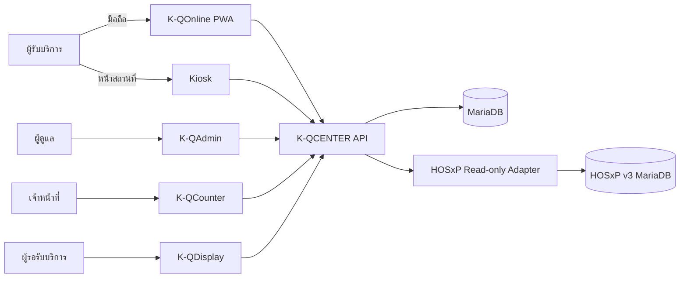
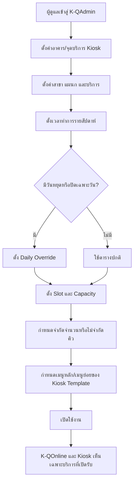
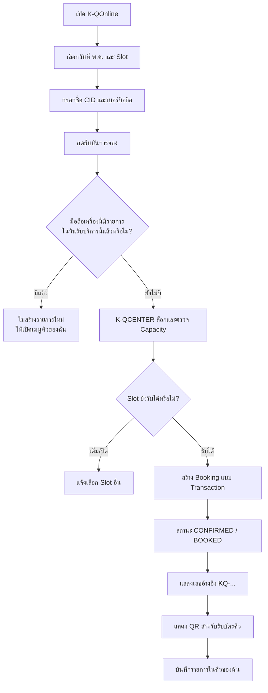
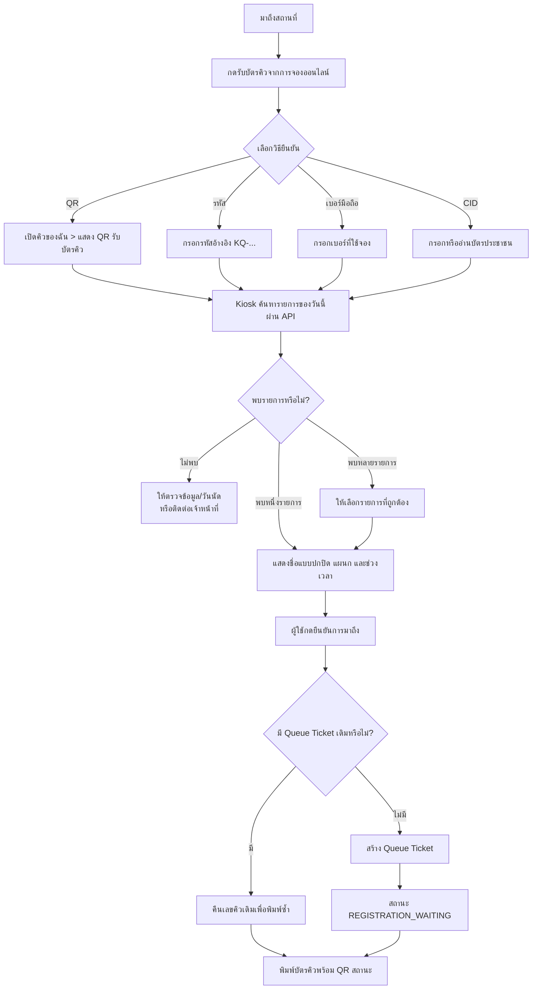
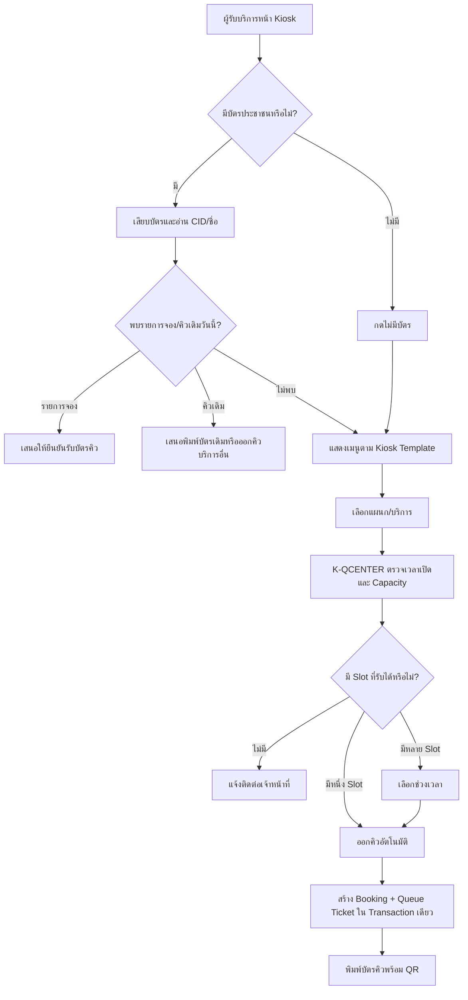
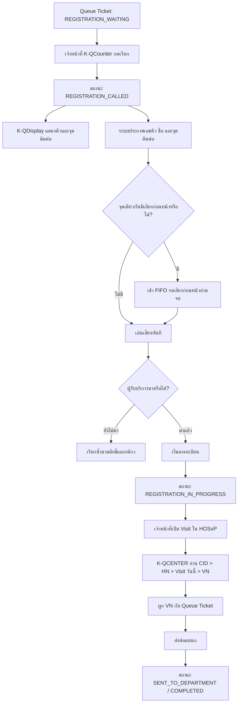
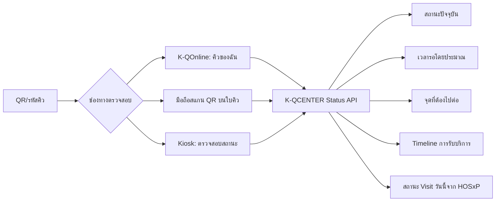
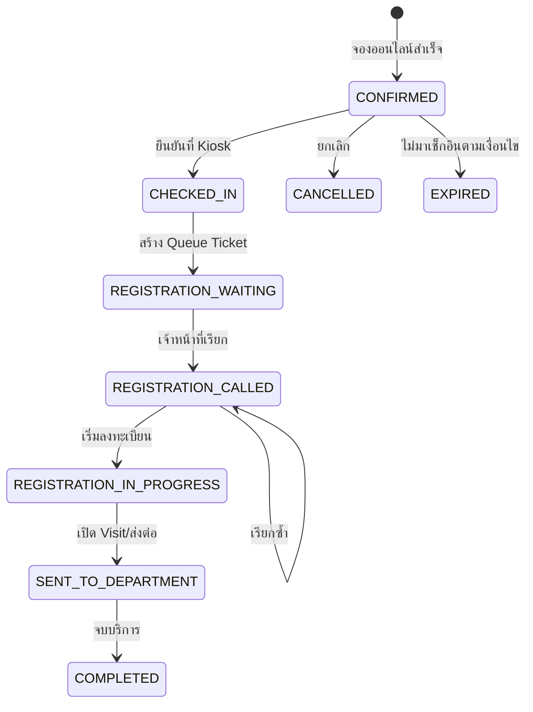

# ผังสรุปการทำงาน K-QOnline และ K-QCENTER

เอกสารนี้สรุปเส้นทางตั้งแต่การตั้งค่าหลังบ้าน การจองออนไลน์ การรับคิว Walk-in การยืนยันรับบัตรคิว การเรียกคิว การติดตามสถานะ และการอ่านสถานะ Visit จาก HOSxP v3

## 1. ขอบเขตของสองระบบ

| ระบบ | ผู้ใช้งาน | หน้าที่หลัก |
|---|---|---|
| **K-QOnline** | ผู้รับบริการผ่านมือถือ/PWA | ดู Slot, จองคิว, เก็บ QR/รหัสอ้างอิง, เปิด QR รับบัตรคิว และติดตามสถานะ |
| **K-QCENTER** | ผู้ดูแล เจ้าหน้าที่ Kiosk Counter และจอ Monitor | ตั้งค่า Slot/Capacity, ตรวจการจอง, ออกบัตรคิว, เรียกคิว, ประกาศเสียง, แสดงสถานะ และเชื่อม HOSxP แบบอ่านอย่างเดียว |

K-QCENTER API เป็นแหล่งข้อมูลหลักของ Slot, Capacity, Booking และ Queue State ทุก Client ติดต่อผ่าน API เท่านั้น



## 2. Flow การตั้งค่าจาก K-QCENTER



## 3. Flow จองออนไลน์ผ่าน K-QOnline



กติกาปัจจุบันคือหนึ่งอุปกรณ์จองออนไลน์ได้หนึ่งรายการต่อหนึ่งวันรับบริการ โดย Client เก็บ Device ID แบบสุ่ม ส่วนเซิร์ฟเวอร์เก็บเฉพาะค่า Hash ผูกกับวันที่ของ Slot

## 4. Flow ยืนยันการจองและรับบัตรคิวที่ Kiosk



การค้นหารายการยังไม่เปลี่ยนสถานะ การเปลี่ยนจาก Booking เป็น Queue Ticket เกิดเมื่อกด **ยืนยันการมาถึงและพิมพ์บัตรคิว** เท่านั้น

## 5. Flow Walk-in ผ่าน Kiosk



## 6. Flow การเรียกคิวและให้บริการ



ระยะแรก K-QCENTER อ่านสถานะ HOSxP อย่างเดียว ไม่ส่งตรวจและไม่เปิด Visit แทนเจ้าหน้าที่

## 7. Flow การติดตามสถานะ



การดูสถานะเป็น Read-only ไม่สร้างคิวและไม่เปลี่ยนสถานะ หาก Booking ยังไม่เช็กอิน K-QOnline จะแสดงปุ่ม **แสดง QR รับบัตรคิว**

## 8. สถานะหลักของ Booking และ Queue



## 9. จุดควบคุมสำคัญ

- วันและเวลาที่ผู้ใช้เห็นเป็น พ.ศ. และ Asia/Bangkok แต่ Timestamp ภายในใช้ UTC/ISO 8601
- Booking และ Walk-in ต้อง Transaction-safe, Capacity-safe และ Idempotent
- การสแกนหรือค้นหาซ้ำต้องไม่สร้างเลขคิวซ้ำ
- K-QOnline และ Kiosk เชื่อมผ่าน API เท่านั้น ห้ามเชื่อม MariaDB/HOSxP โดยตรง
- หน้า Public แสดงชื่อแบบปกปิดและไม่เปิดเผย CID, HN หรือ VN
- Admin, Database, Redis, HOSxP และหน้าหลังบ้านต้องไม่เปิดผ่าน Tailscale Funnel
- สิทธิ์หลังบ้านจำกัดตามองค์กร สาขา แผนก และบทบาท

## 10. สรุปเส้นทางใช้งานแบบสั้น

```text
จองออนไลน์:
K-QOnline → เลือก Slot → จอง → QR/รหัส → Kiosk ยืนยัน → พิมพ์บัตร → Counter เรียก → เปิด Visit → ส่งแผนก

Walk-in:
Kiosk → อ่านบัตร/ไม่มีบัตร → เลือกบริการ → ตรวจ Slot → ออกและพิมพ์บัตร → Counter เรียก → เปิด Visit → ส่งแผนก

ติดตามสถานะ:
คิวของฉัน/QR ใบคิว/Kiosk → K-QCENTER Status API → สถานะ + เวลารอ + จุดถัดไป + HOSxP Visit
```
